# Storage Layout — graphical user guide

Arrange a cabinet front, design drawer interiors, then describe how logical LED
numbers map to physical strings. Native InvenTree locations remain the inventory
source of truth: drawing a rectangle does not itself create a stock location; the
verified save workflow creates and retains native child locations as described below.

**Safety:** this guide is for layout and configuration, not commissioning.
Development has hardware and dispatcher gates **off**. Do not use arm, observe,
discover, locate, test or clear, enable gates, or start workers to follow this guide.
Main is forbidden. See [deployment status](../DEPLOYMENT.md) and the
[hardware readiness runbook](../../src/plugins/storage_layout/LIVE_TEST_READINESS.md).

## Designer workspace — current Development correction

Cabinet and drawer canvases fill the remaining desktop viewport below their
controls and resize with the window. On first open the drawing fits automatically.
Use **Zoom in**, **Zoom out**, **Pan** or **Reset view** to take manual control;
your zoom/pan is then preserved across unrelated edits and window resizing.
**Fit to view** fits again and resumes automatic fitting as the canvas resizes.
This changes only the view, never saved drawing dimensions or inventory.

**Deployed and authenticated-browser verified:** **Expand canvas**
opens either canvas and its drawing toolbar across the full browser viewport,
without the surrounding host panels. Use **Exit full viewport** or the browser's
**Escape** shortcut to return. Existing selections and unsaved edits are retained.
If browser fullscreen is unavailable or denied, the editor expands within the
page instead. **Exit full viewport** and **Escape** also close this fallback,
and normal page scrolling is restored.

Authenticated Development verification on `f099aa1d3` measured a 696px cabinet
canvas and 672px drawer canvases at 1600×1100. At narrow widths, stacked panels
and a minimum usable workspace require vertical scrolling; below 425px the host's
existing mobile gate still applies. [Exact evidence and limits](evidence/WORKSPACE-F099AA1D3.md).

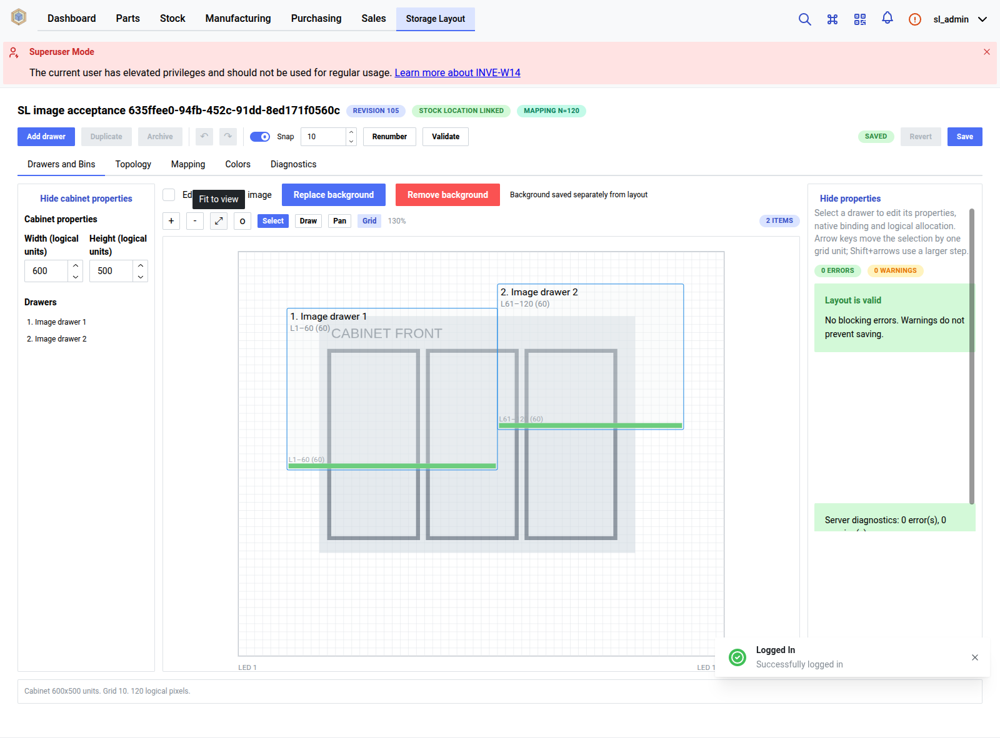

[Current drawer workspace](evidence/workspace-631c8c10-6ed6-4453-a157-f81bd2a79c28/1-1600.png)
and [425px stacked drawer layout](evidence/workspace-631c8c10-6ed6-4453-a157-f81bd2a79c28/1-425.png)
are real authenticated captures with synthetic fixture backgrounds, not shared records.
Older screenshots below show earlier application layouts.

## Start here

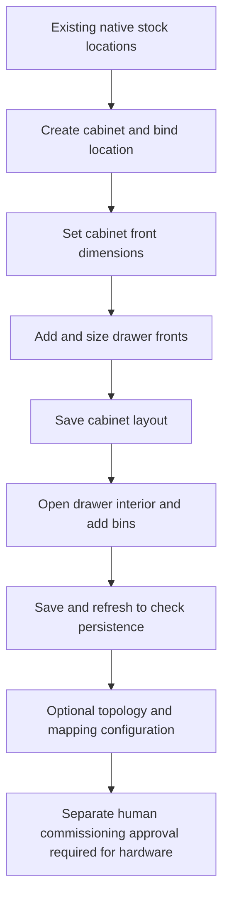

The historical workflow screenshot is the **Mapping** image (`images/06-mapping.png`),
a real Development UI capture from 2026-10-19 using the application build
recorded in [DEPLOYMENT.md](../DEPLOYMENT.md). No cabinet, topology or mapping
changes were submitted for this guide. Mermaid diagrams are illustrative, not screenshots or evidence of a live workflow.
New image-background acceptance screenshots and their isolated-fixture scope are
explicitly identified below.
## Prior browser verification — drawer/bin workflows

Before the Cabinet / Structure deployment, Development browser suites verified
cabinet/drawer editing, Draw bin, move/resize, undo/redo, save/refresh/restart and
collision rejection; a separate populated-stock check retained quantity and location
through drawer/bin rename, archive and repeated saves. That earlier checkpoint ran
review-tag images whose build provenance was not established there. It is historical
context, not evidence about the current Cabinet / Structure image build. See the
[current deployment evidence](../DEPLOYMENT.md#current-deployment-checkpoint--approved-cabinet-structure-feature-activated-in-development).

## 002J-Q background images — Development verified with remaining limits

**Cabinet / Structure** and opening-guided drawer creation are retired. Previously
saved `Cabinet.structure` and its backend API are retained without conversion.
Authenticated desktop Development acceptance now verifies real PNG upload and
independent cabinet/two-drawer images, pointer edits, separate save/reload and
restricted restart persistence with populated stock and active LED allocations.
[Exact evidence, screenshots and remaining acceptance gates](evidence/002J-Q-LIVE-ACCEPTANCE.md).
Historical Structure screenshots remain audit records.

**Responsive correction deployed:** `19d148233` passes actual Chromium
no-horizontal-overflow assertions at 425 px for the cabinet and both drawers,
including image/object pointer move/resize and undo. Real JPEG/WebP uploads,
failed-upload preservation, cancel/confirm image removal and exact restoration,
slow pending-navigation protection, and restricted restart persistence also pass
on retained isolated fixtures. Removal detaches the background, not the cabinet,
drawer, bins or stock. Original invalid-upload, stale-conflict and non-admin/
anonymous permission probes were also rerun successfully on `19d148233`, preserving
all saved fixture images and populated inventory/mapping data. See the linked
evidence for current-runtime HTTP snapshots and exact remaining limits.

**Narrow-view limits:** the host blocks the default UI below 425 px. 390 px captures
use a disposable browser-local mobile override, not the default supported workflow.
No-overflow and image gestures pass there, but object gestures remain unverified
following unchanged-movement probes. Do not treat those captures as full mobile
PASS. Live cross-owner denial is also unverified: shared ownership control is off
and was not changed.

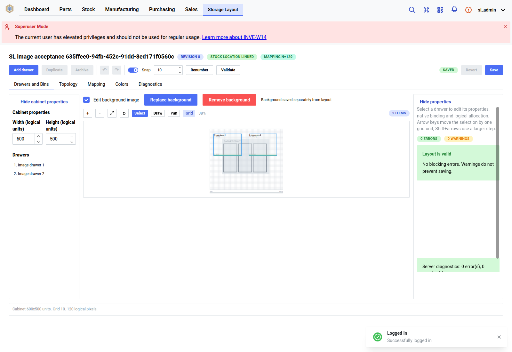

[Distinct drawer one reference](evidence/background-635ffee0-94fb-452c-91dd-8ed171f0560c/desktop-1.png)
and [drawer two reference](evidence/background-635ffee0-94fb-452c-91dd-8ed171f0560c/desktop-2.png)
are actual authenticated Development captures of isolated synthetic reference
rasters, not photographs or shared inventory records.

1. Save or revert layout changes, then choose **Upload background** (PNG/JPEG/WebP,
   at most 8 MiB and 20 million pixels; animated images are rejected). Upload and
   replacement save immediately. Cabinet images are front views; each drawer has
   its own independent top-down reference.
2. Choose **Edit background image**. Ordinary drawer/bin gestures are isolated in
   this mode; dashed object outlines remain reference-only. Uncheck **Lock background**
   to move the image with the canvas/arrow keys or resize with handles or labelled
   numeric controls. **Fit background** centres and fits the intrinsic aspect ratio.
3. **Show background**, **Background opacity**, **Lock background** and **Preserve
   aspect ratio** control presentation only. Aspect preservation is on by default.
   **Undo background**, **Redo background** and **Revert background** affect only the
   image draft. **Save background** explicitly saves metadata, separately from layout.
4. Exit image editing to select, draw, move or resize drawers/bins. Underlays never
   intercept those gestures. The same zoom/pan transform applies to both layers.
5. **Replace background** retains placement/settings. **Remove background** asks for
   confirmation and immediately detaches the reference; old media is retained for
   reference-aware cleanup, not physically deleted. Inventory is never removed.

Position and size are fractions of the current canvas, with top-left origin,
x right and y down. For example width 0.5 spans half the canvas. Changing logical
canvas dimensions scales each reference axis; it does not rewrite metadata or
calibrate physical units. Aspect lock preserves the current placement ratio while
resizing; Fit uses the actual source ratio. No image changes object IDs, rectangle
geometry, stock locations, quantities, topology, mappings or pixel allocations.

Pending saves disable image controls; failed upload/replacement keeps the previous
reference, and metadata save failures keep the draft. Revision conflicts require
reloading the editor after preserving/reverting local work; no automatic merge is
performed. Unsaved image state warns before browser unload. In browsers with the Navigation
API (verified with the local Chromium fixture), changing cabinet/drawer/SPA route
or traversing history asks before discarding dirty work or leaving a pending
request. Cancel keeps the current editor. Older browsers fall back to link-click
and unload guards; programmatic SPA/history navigation there is not guaranteed.
The draft is session-local: save/revert before changing targets. In image mode,
Ctrl/Cmd+Z and Ctrl+Y / Cmd+Shift+Z use image history only while focus is within
the editor, excluding numeric/text inputs (which retain native text undo).
A committed upload whose subsequent preview read/decoding fails is explicitly
reported as **saved, preview unavailable**, not a failed upload; reload to retry.
Image controls use Lingui messages; untranslated catalogs fall back to English.
Local Chromium fixture checks cover reachable controls at 390px and an extreme
10:0.001 normalized transform, not a comprehensive mobile/visual audit. No new
live screenshots were taken; owner screenshots remain unchanged.

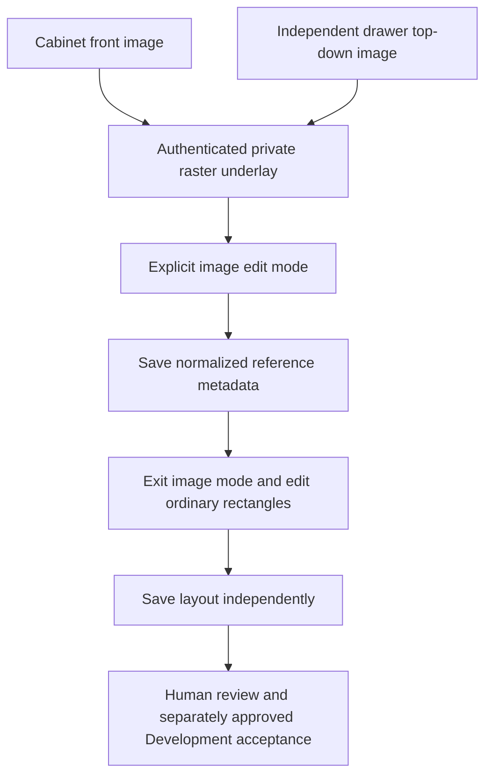

## 1. Find or create a cabinet

### Cabinet list — illustrative workflow, not a screenshot

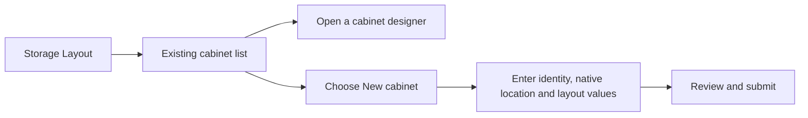

1. Open the **Storage Layout** tab in InvenTree.
2. Open an existing cabinet's designer, or choose **New cabinet** when you intend
   to create a new one. Do not experiment on someone else's cabinet.
3. In the creation dialog, supply the requested identity, select the cabinet's
   parent native location by name in the hierarchy picker, and enter layout values.
   The picker represents native stock locations; it is not a free-text ID field.
4. Review the values before submitting. Cabinet creation uses the selected
   `root_location_name` atomically with cabinet creation; it does not adopt an
   existing location by ID or delete/modify native locations. Closing the dialog
   without submitting avoids creating a cabinet. The deployed UI's Add drawer then
   Save flow was browser-verified to return 200 and automatically create its native
   parent. API checks also verified native root/drawer/bin creation hierarchy,
   stable IDs across repeated saves, and collision rollback without revision/count
   change. These checks do not establish stock-placement acceptance.

### New cabinet setup — illustrative workflow, not a screenshot

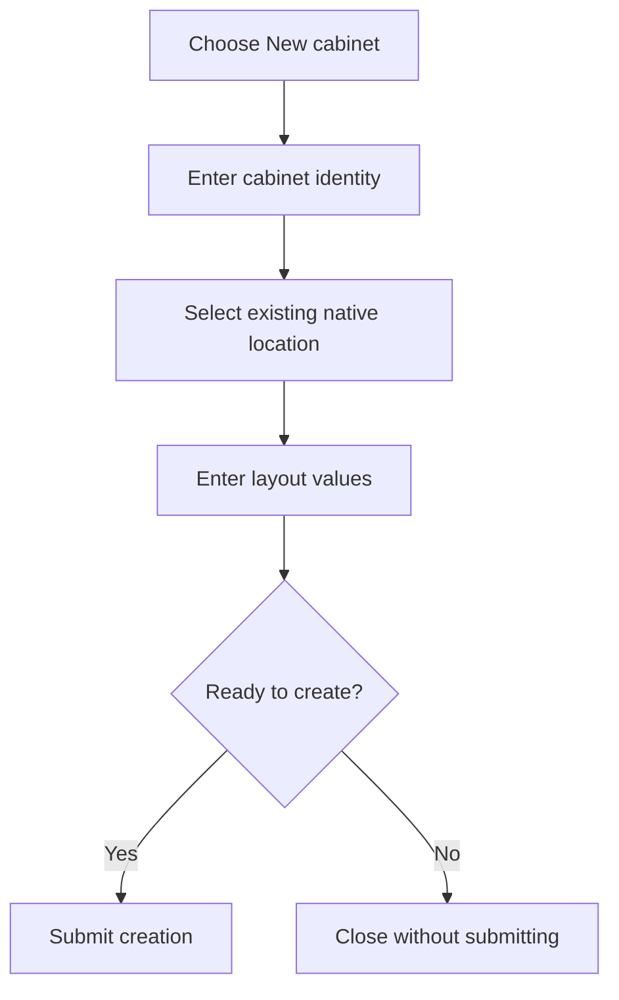

## 2. Set the cabinet dimensions

### Cabinet designer areas — illustrative diagram, not a screenshot

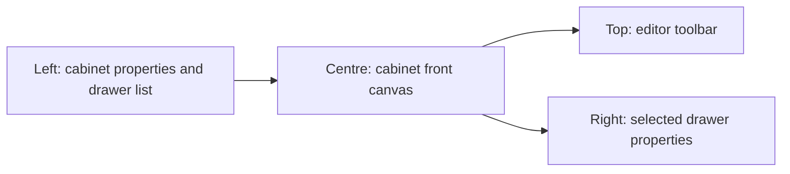

Read the screen from left to right:

| Area | What to do |
| --- | --- |
| **Cabinet properties**, left | Expand **Show cabinet properties** if hidden. Set **Width (units)** and **Height (units)** for the cabinet front. |
| **Drawers**, left | Select an existing drawer to edit it. |
| Canvas, centre | Inspect placement, select rectangles, drag to move and use selection handles to resize. Zoom/grid controls affect the view, not the stored cabinet dimensions. |
| Properties, right | Edit the selected drawer's numeric values precisely. Expand **Show properties** if needed. |
| Toolbar, top | Add, duplicate, archive, undo/redo, set snapping/grid, validate, revert or save. |

The UI uses **logical layout units**, not an enforced millimetre scale. Pick a consistent
scale for your drawing. A cabinet's width/height describe its **front**, not its
depth. Changing the cabinet bounds is not an instruction to proportionally scale
all drawers: check their positions and sizes afterwards.

## 3. Add and size drawers

### Drawer front and properties — illustrative diagram, not a screenshot

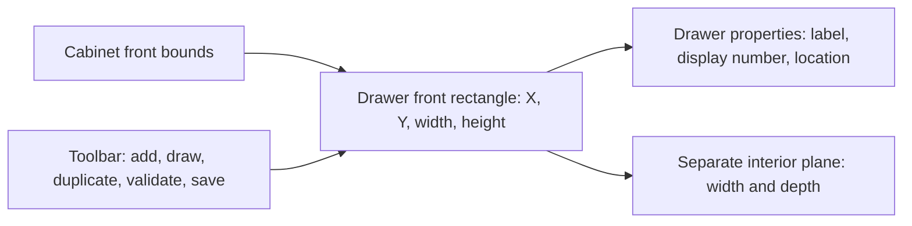

This illustration is not a browser capture. The controls shown were verified in
the live browser suite, but the illustration itself is not evidence or a screenshot.

1. To place a drawer by size, choose **Add drawer**, then select its rectangle
   or list entry. To draw its size and position directly, turn on **Draw drawer**
   above the canvas, then click and drag across the cabinet front; turn the button
   off to return to selecting and moving drawers. The preview follows the drag,
   and grid snapping applies when enabled. A drawn rectangle must fit within the
   cabinet bounds and must not overlap another drawer.
2. Set **Label** and **Display number**. These identify the drawer; they are not
   LED addresses.
3. Under **Front rectangle**, set **X**, **Y**, **Width**, and **Height**. X/Y locate
   the drawer on the cabinet front; width/height size that rectangle.
4. Under **Interior (top-down plane)**, set **Interior width** and **Interior
   depth**. These define the separate bin-design plane, not the drawer front.
5. Set **Location ID** to the intended existing native location when binding
   inventory. **Edit native** opens the native editing workflow; it is not a
   harmless preview. An unbound drawer cannot resolve inventory.
6. Use **Snap** and **Grid size** for regular placement. For precise dimensions,
   use numeric fields instead of estimating from the screen. Arrow keys move
   the selected drawer; Shift+arrows use a larger step.
7. Choose **Validate** and address reported conflicts before **Save**. Duplicate
   and archive affect the layout; do not use them casually on shared data.

The named hierarchy picker selects native StockLocations by name, rather than
asking users to type numeric IDs. The deployed API's automatic location creation
was verified for root, drawer and bin hierarchy, stable IDs across repeated saves,
and transactional collision rollback. The live UI specifically verified Add drawer
then Save; do not infer that the UI's Add bin or an unimplemented Draw bin action
has automatic location creation. Automatic creation does not rename, reparent, or
delete native locations. Existing explicit bindings are retained; this workflow does
not adopt existing locations by ID or delete native locations. Existing stock data
was not touched, which is not stock-placement acceptance.

### Front versus interior — illustrative diagram, not a screenshot

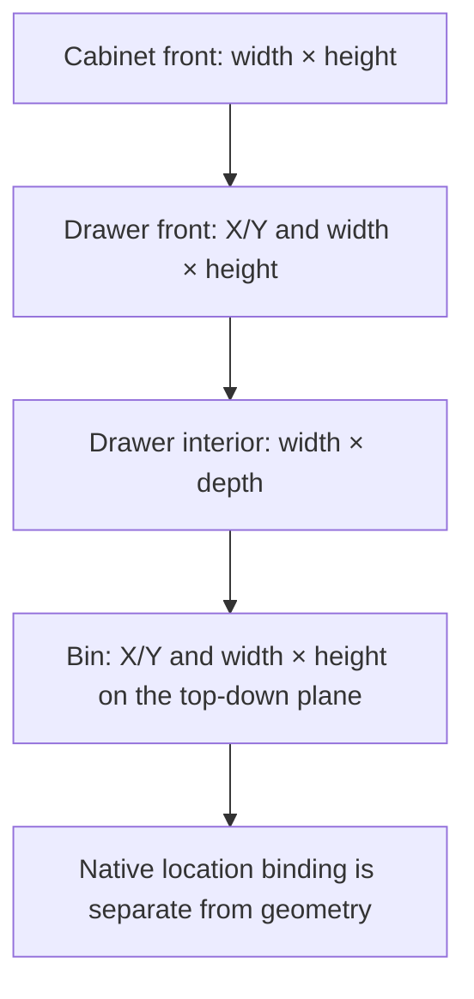

## 4. Design bins inside a drawer

Live authenticated browser acceptance verified **Draw bin** on the currently running
Development review-tag images, alongside Add/edit, movement/resizing, save/reload,
stable native identities and automatic correct parent. The images' build provenance
was not established by that session; the expected prior image IDs did not match, so
build and activation were stopped. See [deployment evidence](../DEPLOYMENT.md).
The diagram below remains illustrative, not a screenshot. Bins are nonstructural
native children; they do not require the structural-child Location ID required by
drawers.

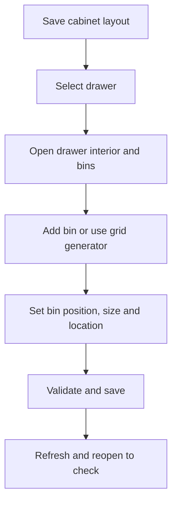

1. **Save the cabinet layout first**, select the drawer, then choose **Design
   drawer interior and bins** in its properties area (scroll down if necessary).
2. Use **Add bin** to place a bin directly, or **Draw bin** to draw its size and
   position with a click-and-drag gesture. Use **Grid generator** for a regular
   arrangement if available, reviewing generator settings before applying.
3. Select a bin in the **Bins** list or top-down canvas. Use its inspector for
   label, position, size and native location binding. Here the plane is the
   drawer interior: bin height runs along the interior depth, not the cabinet's
   vertical front.
4. Keep bins inside the interior bounds and resolve reported conflicts. Use
   **Duplicate**, snapping and grid spacing for repeated sizes. **Delete bin**
   is a change, not a selection-clearing tool.
5. Choose **Save**, refresh and reopen the drawer to check the saved bin layout.
   Use the cabinet breadcrumb to return to the front view.

## 5. Save, refresh and recover safely

1. Look for **Unsaved changes** after edits. There is no promise of automatic
   server saving; click **Save** in the designer you edited.
2. Wait for completion. If **Save failed** or validation errors appear, keep
   the page open and resolve them. A green **Saved** badge alone does not prove
   that a particular intended edit survived a reload.
3. After a successful save, refresh and reopen the same cabinet/drawer. Check
   numeric dimensions, positions and bindings, not only the drawing's appearance.
4. **Undo/Redo** operate on editing history. **Revert** discards the local edits
   and reloads server state; it does not undo an already-saved server revision.
5. A stale-revision/conflict error means the server changed since loading. Record
   your intended values, reload, compare and reapply only what is still wanted.
   Do not repeatedly overwrite another editor's changes.

If the screen is empty, first check the selected cabinet, drawer list and zoom.
If controls are unavailable, check loading/errors and edit permissions rather
than enabling hardware or starting background services.

## 6. Optional: describe the electrical topology (configuration only)

### Topology editor — illustrative workflow, not a screenshot

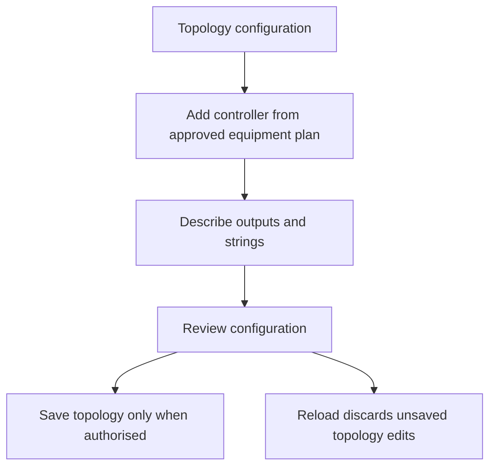

**Topology** is a separate configuration editor with its own **Save topology**
and **Reload** controls. Finish or discard unsaved layout edits before saving it.
For an authorised configuration change:

1. Add a controller and enter its name and approved origin (`scheme://host:port`),
   expected MAC and firmware adapter from the equipment plan. Do not enter
   passwords or tokens into origins or screenshots.
2. Add outputs: bus, WLED start, pixel count, colour order and pins must describe
   the actual planned equipment, not guessed values.
3. Add strings with their label, offset and pixel count. Check output limits.
   **Bus reverse** and **Skip** configurations marked unsupported are not live-ready.
4. Review, then **Save topology** only if authorised to change stored config.
   **Reload** retrieves stored topology and discards local topology edits.

New controllers, outputs and strings receive their saved IDs from the server on
save; subsequent edits retain those IDs. A local source fix corrects the editor
sending unsaved IDs as existing records (`Unknown or cross-cabinet controller id`).
This fix has not yet been deployed or live-browser verified.

Saving configuration is not discovery, a connectivity test, or proof of wiring.
No controller was added or queried for this guide; the diagram above is illustrative.

## 7. Optional: understand LED allocation and mapping


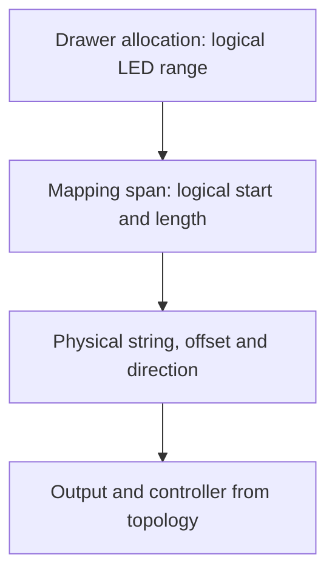

- **Total logical pixels (N)** sets the logical address space. Logical numbering
  starts at **1**; physical offsets start at **0**. A range's end is inclusive.
- **Add span** describes a logical start, length, physical string, offset and
  forward/reversed direction. Cover `1…N` without logical gaps or overlaps and
  stay within physical string bounds.
- Drawer properties expose a logical allocation; bins can describe subranges.
  Do not confuse these logical ranges with rectangle coordinates or display numbers.
- **Preview** validates a candidate and shows translation samples and drawer
  impacts. It does not illuminate LEDs. Review errors and affected drawers.
- **Publish mapping** persists a mapping revision; it is not the designer's
  **Save** button. Publishing can change allocations and invalidate previous
  hardware approvals. Only publish when authorised and after reviewing impacts.

For example, a logical span starting at 1, length 10, string offset 0, forward
maps logical 1 to physical offset 0 and logical 10 to offset 9. This is an
illustration, not configuration for the captured cabinet (which has no mapping).
No preview or publication was submitted for this guide. **No hardware access**
on the mapping screen is not a commissioning approval. Keep hardware gates off;
follow the separate human-reviewed runbook before any physical operation.

## Maintaining this guide

Whenever Storage Layout changes, review this guide in the same change. Update
steps, labels, diagrams and affected screenshots for UI/workflow changes. For
backend-only changes, check saving, validation, mapping and safety statements;
record explicitly when no guide change is needed. See the repository
[agent requirement](../../AGENTS.md) and [plugin contributor notes](../../src/plugins/storage_layout/README.md).

The capture helper is
[`capture-storage-layout-guide.cjs`](../../contrib/remote-development/capture-storage-layout-guide.cjs).
It requires the existing frontend Playwright dependency/browser, approved Dev
access and the approved in-memory SSH password retrieval described by the
verification environment. Run from the repository root:

```sh
node --check contrib/remote-development/capture-storage-layout-guide.cjs
node contrib/remote-development/capture-storage-layout-guide.cjs
```

If Chromium is not installed at Playwright's default location, set
`SL_CHROMIUM_PATH` to an existing approved browser executable. Do not install or
change deployment services just to capture documentation. The helper targets only
the fixed Development origin and existing integration cabinet, blocks non-GET/HEAD
browser traffic after login and blocks hardware endpoints. It never clicks Save,
Publish or hardware actions. It briefly adds an unsaved drawer if needed and
reloads to discard it. It stores no auth state, traces or login images. Inspect
every image for sensitive information before including it; do not publish
credentials, controller secrets or private inventory. Capture failures deliberately
omit exception details to avoid leaking authenticated state. The initial six-image
capture succeeded, but only `images/06-mapping.png` is present in this guide;
the other capture images are not embedded here. Subsequent regeneration attempts
stalled during designer navigation. The helper is syntax-checked, but repeatable
end-to-end regeneration is not yet verified; do not mistake a partial rerun for a
complete refreshed image set.
