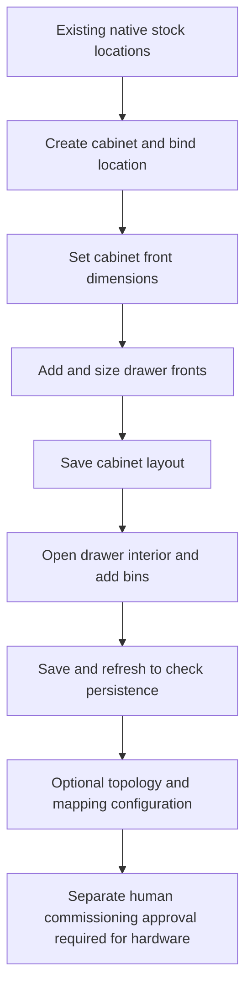
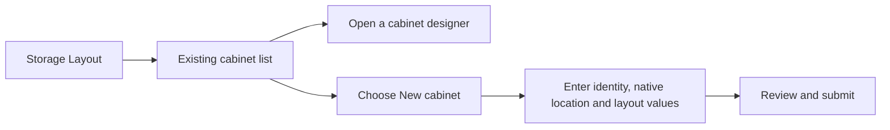
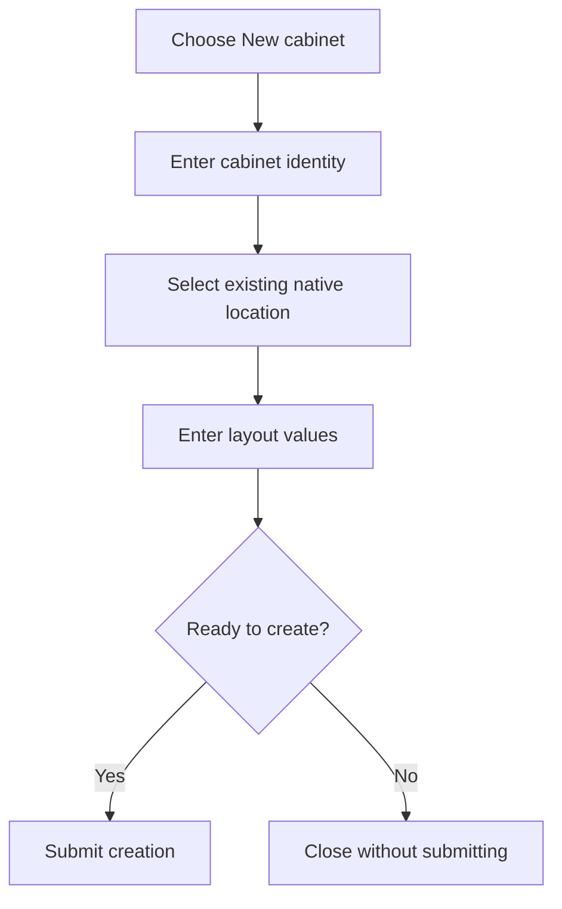
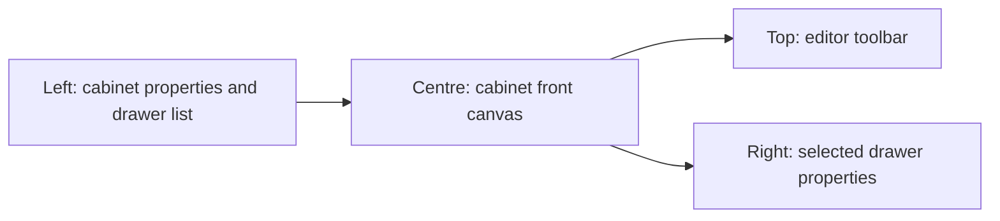
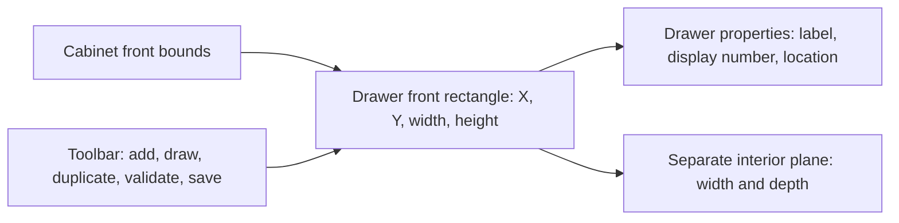
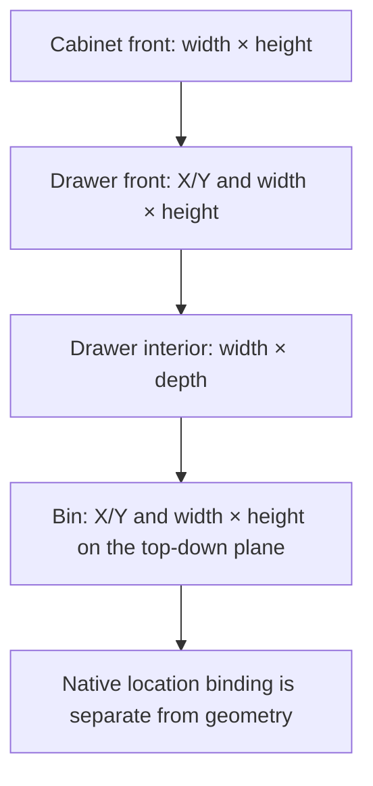
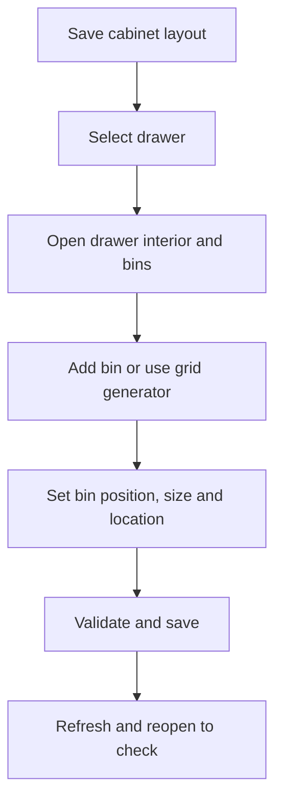
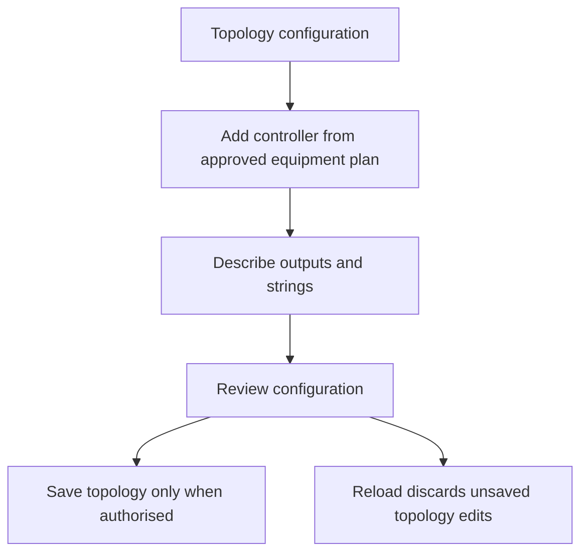
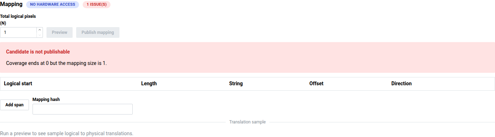
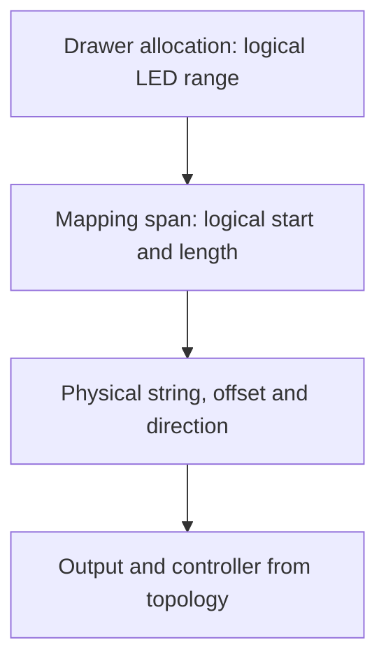

# Storage Layout — graphical user guide

Arrange a cabinet front, design drawer interiors, then describe how logical LED
numbers map to physical strings. Native InvenTree locations remain the inventory
source of truth: drawing a rectangle does not create a stock location.

**Safety:** this guide is for layout and configuration, not commissioning.
Development has hardware and dispatcher gates **off**. Do not use arm, observe,
discover, locate, test or clear, enable gates, or start workers to follow this guide.
Main is forbidden. See [deployment status](../DEPLOYMENT.md) and the
[hardware readiness runbook](../../src/plugins/storage_layout/LIVE_TEST_READINESS.md).

## Start here



The only embedded screenshot is the **Mapping** image (`images/06-mapping.png`),
a real Development UI capture from 2026-10-19 using the application build
recorded in [DEPLOYMENT.md](../DEPLOYMENT.md). No cabinet, topology or mapping
changes were submitted for this guide. All other diagrams in this guide are
illustrative Mermaid diagrams, not screenshots or evidence of a live workflow.
The deployed app remains `2bb7375ed`; the newer picker and automatic native-child
creation described below are source-tested, not deployed or browser-verified.
A live browser suite passed on the deployed app `2bb7375ed`. It verified cabinet
dimensions (641 × 841) through Save, refresh and restart; Add and Duplicate through
Save and refresh; drawing a 100 × 80 drawer at (200, 200) through Save and refresh;
snap-to-10 movement from (0, 0) to (30, 30); resizing from 60 × 40 to 80 × 60;
undo/redo; inspector width 79; adding a bin bound to a native child (width 21)
through Save and refresh; archive/duplicate; and snapshot identity/geometry across
container restart. This is browser verification, not hardware testing. No screenshots
from that suite are included or implied here. Multi-select, align and distribute are
covered by source inspection only and were not acceptance-tested in this run.

## 1. Find or create a cabinet

### Cabinet list — illustrative workflow, not a screenshot



1. Open the **Storage Layout** tab in InvenTree.
2. Open an existing cabinet's designer, or choose **New cabinet** when you intend
   to create a new one. Do not experiment on someone else's cabinet.
3. In the creation dialog, supply the requested identity, select the cabinet's
   parent native location by name in the hierarchy picker, and enter layout values.
   The picker represents native stock locations; it is not a free-text ID field.
4. Review the values before submitting. Cabinet creation uses the selected
   `root_location_name` atomically with cabinet creation; it does not adopt an
   existing location by ID or delete/modify native locations. Closing the dialog
   without submitting avoids creating a cabinet. This updated picker/create flow
   is source-tested only, not verified in the deployed browser.

### New cabinet setup — illustrative workflow, not a screenshot



## 2. Set the cabinet dimensions

### Cabinet designer areas — illustrative diagram, not a screenshot



Read the screen from left to right:

| Area | What to do |
| --- | --- |
| **Cabinet properties**, left | Expand **Show cabinet properties** if hidden. Set **Width (units)** and **Height (units)** for the cabinet front. |
| **Drawers**, left | Select an existing drawer to edit it. |
| Canvas, centre | Inspect placement, select rectangles, drag to move and use selection handles to resize. Zoom/grid controls affect the view, not the stored cabinet dimensions. |
| Properties, right | Edit the selected drawer's numeric values precisely. Expand **Show properties** if needed. |
| Toolbar, top | Add, duplicate, archive, undo/redo, set snapping/grid, validate, revert or save. |

The UI uses **logical layout units**, not an enforced millimetre scale. Pick a consistent
scale for your drawing. A cabinet's width/height describe its **front**, not its
depth. Changing the cabinet bounds is not an instruction to proportionally scale
all drawers: check their positions and sizes afterwards.

## 3. Add and size drawers

### Drawer front and properties — illustrative diagram, not a screenshot



This illustration is not a browser capture. The controls shown were verified in
the live browser suite, but the illustration itself is not evidence or a screenshot.

1. To place a drawer by size, choose **Add drawer**, then select its rectangle
   or list entry. To draw its size and position directly, turn on **Draw drawer**
   above the canvas, then click and drag across the cabinet front; turn the button
   off to return to selecting and moving drawers. The preview follows the drag,
   and grid snapping applies when enabled. A drawn rectangle must fit within the
   cabinet bounds and must not overlap another drawer.
2. Set **Label** and **Display number**. These identify the drawer; they are not
   LED addresses.
3. Under **Front rectangle**, set **X**, **Y**, **Width**, and **Height**. X/Y locate
   the drawer on the cabinet front; width/height size that rectangle.
4. Under **Interior (top-down plane)**, set **Interior width** and **Interior
   depth**. These define the separate bin-design plane, not the drawer front.
5. Set **Location ID** to the intended existing native location when binding
   inventory. **Edit native** opens the native editing workflow; it is not a
   harmless preview. An unbound drawer cannot resolve inventory.
6. Use **Snap** and **Grid size** for regular placement. For precise dimensions,
   use numeric fields instead of estimating from the screen. Arrow keys move
   the selected drawer; Shift+arrows use a larger step.
7. Choose **Validate** and address reported conflicts before **Save**. Duplicate
   and archive affect the layout; do not use them casually on shared data.

The named hierarchy picker selects native StockLocations by name, rather than
asking users to type numeric IDs. When a cabinet is created, its selected
`root_location_name` is created atomically with the cabinet; the source does not
adopt an existing location. When saving a layout, a row with `location: null` and
`auto_create_location: true` creates a native child location: a structural child
for a drawer, or a nonstructural child for a bin. These creation operations are
transactional with their respective cabinet/layout saves. They do not rename,
reparent, or delete native locations. Existing explicit bindings are retained;
there is no native stock-location deletion or adoption feature in this workflow.
A drawer requires a native cabinet location as its parent. This behavior is
source-tested only and has not been browser-verified or deployed. The live
Development app remains at source `2bb7375ed`; see [checkpoint 002J-N](../DEPLOYMENT.md#checkpoint-002j-n--storage-layout-source-tested-update-not-deployed).

### Front versus interior — illustrative diagram, not a screenshot



## 4. Design bins inside a drawer

The live browser suite verified adding a bin, binding it to a native child, and
saving/reloading its geometry. The diagram below remains illustrative, not a
screenshot. Bins are nonstructural native children; they do not require the
structural-child Location ID required by drawers.



1. **Save the cabinet layout first**, select the drawer, then choose **Design
   drawer interior and bins** in its properties area (scroll down if necessary).
2. In the drawer designer, use **Add bin**, or **Grid generator** for a regular
   arrangement. Review generator settings before applying them.
3. Select a bin in the **Bins** list or top-down canvas. Use its inspector for
   label, position, size and native location binding. Here the plane is the
   drawer interior: bin height runs along the interior depth, not the cabinet's
   vertical front.
4. Keep bins inside the interior bounds and resolve reported conflicts. Use
   **Duplicate**, snapping and grid spacing for repeated sizes. **Delete bin**
   is a change, not a selection-clearing tool.
5. Choose **Save**, refresh and reopen the drawer to check the saved bin layout.
   Use the cabinet breadcrumb to return to the front view.

## 5. Save, refresh and recover safely

1. Look for **Unsaved changes** after edits. There is no promise of automatic
   server saving; click **Save** in the designer you edited.
2. Wait for completion. If **Save failed** or validation errors appear, keep
   the page open and resolve them. A green **Saved** badge alone does not prove
   that a particular intended edit survived a reload.
3. After a successful save, refresh and reopen the same cabinet/drawer. Check
   numeric dimensions, positions and bindings, not only the drawing's appearance.
4. **Undo/Redo** operate on editing history. **Revert** discards the local edits
   and reloads server state; it does not undo an already-saved server revision.
5. A stale-revision/conflict error means the server changed since loading. Record
   your intended values, reload, compare and reapply only what is still wanted.
   Do not repeatedly overwrite another editor's changes.

If the screen is empty, first check the selected cabinet, drawer list and zoom.
If controls are unavailable, check loading/errors and edit permissions rather
than enabling hardware or starting background services.

## 6. Optional: describe the electrical topology (configuration only)

### Topology editor — illustrative workflow, not a screenshot



**Topology** is a separate configuration editor with its own **Save topology**
and **Reload** controls. Finish or discard unsaved layout edits before saving it.
For an authorised configuration change:

1. Add a controller and enter its name and approved origin (`scheme://host:port`),
   expected MAC and firmware adapter from the equipment plan. Do not enter
   passwords or tokens into origins or screenshots.
2. Add outputs: bus, WLED start, pixel count, colour order and pins must describe
   the actual planned equipment, not guessed values.
3. Add strings with their label, offset and pixel count. Check output limits.
   **Bus reverse** and **Skip** configurations marked unsupported are not live-ready.
4. Review, then **Save topology** only if authorised to change stored config.
   **Reload** retrieves stored topology and discards local topology edits.

Saving configuration is not discovery, a connectivity test, or proof of wiring.
No controller was added or queried for this guide; the diagram above is illustrative.

## 7. Optional: understand LED allocation and mapping





- **Total logical pixels (N)** sets the logical address space. Logical numbering
  starts at **1**; physical offsets start at **0**. A range's end is inclusive.
- **Add span** describes a logical start, length, physical string, offset and
  forward/reversed direction. Cover `1…N` without logical gaps or overlaps and
  stay within physical string bounds.
- Drawer properties expose a logical allocation; bins can describe subranges.
  Do not confuse these logical ranges with rectangle coordinates or display numbers.
- **Preview** validates a candidate and shows translation samples and drawer
  impacts. It does not illuminate LEDs. Review errors and affected drawers.
- **Publish mapping** persists a mapping revision; it is not the designer's
  **Save** button. Publishing can change allocations and invalidate previous
  hardware approvals. Only publish when authorised and after reviewing impacts.

For example, a logical span starting at 1, length 10, string offset 0, forward
maps logical 1 to physical offset 0 and logical 10 to offset 9. This is an
illustration, not configuration for the captured cabinet (which has no mapping).
No preview or publication was submitted for this guide. **No hardware access**
on the mapping screen is not a commissioning approval. Keep hardware gates off;
follow the separate human-reviewed runbook before any physical operation.

## Maintaining this guide

Whenever Storage Layout changes, review this guide in the same change. Update
steps, labels, diagrams and affected screenshots for UI/workflow changes. For
backend-only changes, check saving, validation, mapping and safety statements;
record explicitly when no guide change is needed. See the repository
[agent requirement](../../AGENTS.md) and [plugin contributor notes](../../src/plugins/storage_layout/README.md).

The capture helper is
[`capture-storage-layout-guide.cjs`](../../contrib/remote-development/capture-storage-layout-guide.cjs).
It requires the existing frontend Playwright dependency/browser, approved Dev
access and the approved in-memory SSH password retrieval described by the
verification environment. Run from the repository root:

```sh
node --check contrib/remote-development/capture-storage-layout-guide.cjs
node contrib/remote-development/capture-storage-layout-guide.cjs
```

If Chromium is not installed at Playwright's default location, set
`SL_CHROMIUM_PATH` to an existing approved browser executable. Do not install or
change deployment services just to capture documentation. The helper targets only
the fixed Development origin and existing integration cabinet, blocks non-GET/HEAD
browser traffic after login and blocks hardware endpoints. It never clicks Save,
Publish or hardware actions. It briefly adds an unsaved drawer if needed and
reloads to discard it. It stores no auth state, traces or login images. Inspect
every image for sensitive information before including it; do not publish
credentials, controller secrets or private inventory. Capture failures deliberately
omit exception details to avoid leaking authenticated state. The initial six-image
capture succeeded, but only `images/06-mapping.png` is present in this guide;
the other capture images are not embedded here. Subsequent regeneration attempts
stalled during designer navigation. The helper is syntax-checked, but repeatable
end-to-end regeneration is not yet verified; do not mistake a partial rerun for a
complete refreshed image set.
