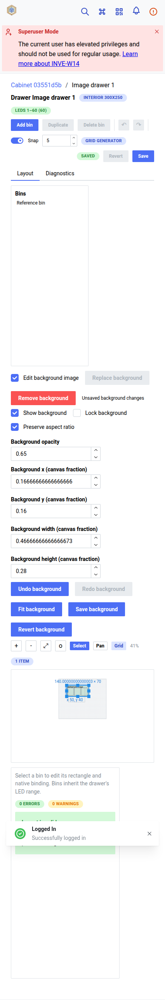

# 002J-Q live Development image acceptance — verified with limits, 2026-10-20

## Responsive deployment follow-up 19d148233

**PASS_WITH_DOCUMENTED_LIMITATIONS**, not unconditional mobile/cross-owner acceptance.
The original baseline findings below are historical. Deployed application is now
`19d148233b278a4ef6309555eb2cc36b39c72050`, archive SHA-256
`9461b1de0e7e6c8efa42bde48576002d38cc828ea0779cd74ff4078c3cab3e73`.
Read-only running-image inspection confirmed backend
`sha256:8c4f55d8f6a607b06f91f9759c292c49fab6517d0d3810dcba0a8b71161d3f1b`
and frontend `sha256:4b6cc8989850ce4f8ce75461c26e9852893e999896200694339799598661a4f4`.

[Final follow-up report: 24 passing checkpoints, HTTP observations, snapshots and screenshot hashes](background-followup-00bf8133-1ab1-457c-8ed0-8d429314ac58/report.json).
Uses the original cabinet, both original drawers, bins, native locations, stock and
active mapping listed below. The first drawer ID in the initial follow-up runner
was a transcription error; the original report already has the correct ID. No
fixture ID drift was demonstrated. No fixture records were deleted.

Actual authenticated Chromium checks on each of the three backgrounds:

- Abort only the fixture multipart POST in the browser: visible error, unchanged
  saved metadata/content hash, unchanged data after reload. This injects a genuine
  network failure, not a fake success response.
- Real JPEG and WebP uploads from browser-generated valid rasters; HTTP 200,
  normalized PNG content and rendered image after reload. These are not photographs.
- Cancel removal preserves data; confirm sends DELETE **only to the isolated
  background endpoint**, yields null image reference and remains detached on reload.
  Reupload original source bytes and restore all metadata: exact metadata/content
  hash equality. No cabinet/drawer/bin/stock/user deletion.
- Delay the cabinet upload request locally; pending controls disabled; dismissed
  host navigation stays put; release the real request, HTTP 200, clean navigation
  succeeds. Final saved image data retained.
- 425×844 default supported narrow viewport: cabinet and both drawers have no
  document horizontal overflow; actual image and object mouse-pointer move/resize,
  image undo/redo, object undo; all geometry drafts reverted without layout writes.
- 390×844 **browser-local allowMobile override**: all three editors have no document
  horizontal overflow; image pointer move/resize and undo/redo pass. Object movement
  at 390 remained unchanged in bounded cabinet probes and is **not accepted**;
  remaining drawer object probes were not run. Tiny override canvas hit-target/
  scale behavior needs separate investigation; no speculative source fix made.
- Restricted Development restart: all three PNG content hashes/metadata exactly
  preserved; exact post-edit layout/stock/location/mapping/allocation/topology
  snapshots preserved, including aggregate revisions; authenticated desktop renders
  all three images after restart. Image writes intentionally advance aggregate CAS
  revision; before/after edit preservation excludes only revision keys, with full
  raw snapshots retained. No other data exclusions.

The request boundary rejected only host observability POSTs to
`/api/system-internal/observability/end`; they remain recorded, not silently allowed.
No hardware or external-origin requests occurred. No shared settings were changed.
The original invalid-upload/CAS/non-admin probes were subsequently rerun on this
correction; see the current-runtime security resume below. Original desktop controls
regression remains historical evidence: the follow-up does not repeat every desktop
opacity/visibility/locking action. All original image metadata/bytes were restored.

After restart, read-only `prepare-002jq.py` `verify_activation()` passed using
`/var/backups/myinventree-dev/002jq-responsive-19d148233-evidence`. It checked
candidate images, mounts, db/redis identities, successful bootstrap, applied 0005,
Compose identity, hardware gates and unrelated container IDs. Correction source
record matched SHA/archive above. All four services separately inspected healthy.
The retained original backup is `/var/backups/myinventree-dev/20261020T091716Z`;
original full-media restore/scratch migration PASS and checksum record were read,
not recreated. No fresh backup/restore or rehash of backup payloads was performed.
Original rehearsal/backup untouched. No schema change, build or activation here.

### Corrected deployment screenshots



[Second narrow drawer](background-followup-00bf8133-1ab1-457c-8ed0-8d429314ac58/pointer-425-2.png),
[failed upload with saved image retained](background-followup-00bf8133-1ab1-457c-8ed0-8d429314ac58/failed-upload-1.png),
[detached drawer image](background-followup-00bf8133-1ab1-457c-8ed0-8d429314ac58/detached-1.png),
[pending navigation blocked](background-followup-00bf8133-1ab1-457c-8ed0-8d429314ac58/pending-navigation-blocked.png),
[restored cabinet after restart](background-followup-00bf8133-1ab1-457c-8ed0-8d429314ac58/restart-desktop-0.png).
Full screenshot list and hashes are in the report; screenshots are credential-free.

### Exact follow-up command

```sh
SL_BACKGROUND_RESTART_APPROVED=1 SL_BACKGROUND_FOLLOWUP_APPROVED=1 SL_ACCEPTANCE_APPLICATION=19d148233b278a4ef6309555eb2cc36b39c72050 SL_CHROMIUM_PATH=/bin/chromium node contrib/remote-development/live-background-followup.cjs docs/storage-layout/evidence/background-635ffee0-94fb-452c-91dd-8ed171f0560c/report.json
```

Earlier failed runner reports remain for audit: mistyped fixture ID, ambiguous alert
locator, object collision/boundary or hit-target gesture probes, aggregate revision
comparison, and expected blocked host telemetry. These were harness issues or
unresolved probes, not silently counted as passing product behavior. Two restricted
restarts occurred during these follow-up runs; both passed data preservation, with
the earlier runner failing only its final telemetry assertion. No app source change.

Live cross-owner denial remains unavailable without changing shared
`STOCK_OWNERSHIP_CONTROL=False`; do not infer it from baseline non-admin 403s.
No host reboot, Main, hardware, workers, shared-record changes, unrelated lifecycle
operations. The lead built and deployed the correction; acceptance made no
application source changes. Documentation/evidence remain uncommitted. Full
default-mobile or exhaustive current-build control coverage is not claimed.

### Current-runtime security resume — 8 passing checkpoints

[Successful report, HTTP statuses and before/after snapshots](background-d3b788aa-a36a-4e32-b7e1-1875edfbfff7/report.json)
and [actual browser stale-conflict screenshot](background-d3b788aa-a36a-4e32-b7e1-1875edfbfff7/stale-conflict.png).
Reused the retained cabinet, drawers, stock and restricted user; no new records,
record deletion or ownership-setting changes. The isolated restricted user's
password was rotated in memory for a genuine authenticated non-admin session.

- SVG, corrupt PNG, >8 MiB upload and invalid opacity: HTTP 400, unchanged saved
  metadata/content; missing If-Match 428 and stale If-Match 412.
- Actual concurrent metadata save followed by browser Save: HTTP 412; unsaved
  opacity draft retained, then reverted. Dirty SPA navigation blocked; clean passed.
- Cabinet and both drawers: non-admin GET/PATCH/POST metadata/upload and GET
  content all HTTP 403; anonymous cabinet content denied.
- Exact three saved image metadata/content hashes and populated stock, five native
  locations, active mapping, topology and allocations preserved. CAS revision
  advances on the intentional concurrent save; no layout/stock change.
- Read-only Docker inspection after the run confirmed both exact corrected image
  IDs above, healthy. No restart needed; prior corrected-runtime restart evidence
  remains the separate 24-checkpoint report.

```sh
SL_BACKGROUND_SECURITY_RESUME=1 SL_ACCEPTANCE_APPLICATION=19d148233b278a4ef6309555eb2cc36b39c72050 SL_CHROMIUM_PATH=/bin/chromium node contrib/remote-development/live-background-acceptance.cjs docs/storage-layout/evidence/background-635ffee0-94fb-452c-91dd-8ed171f0560c/report.json
```

First attempt passed security checks but hit HTTP 429 on the subsequent ownership
setting read. Its failed report is retained locally; a bounded three-second pause
before that read yielded the successful complete rerun. No product defect inferred.
Cross-owner live authorization still cannot be claimed with ownership control off.

The lead reported full frontend **329 passed**, typecheck passed, and tooling
unittest discovery **13 passed**. Final acceptance independently ran current tooling
discovery: **28 passed**; `node --check` passed for both background runners.
No frontend source or tests changed in this acceptance turn.

Secret audit before staging: 18 acceptance text reports/scripts/documentation files
checked against current runtime password/token/secret values in memory, plus
private-key/Bearer/auth-cookie pattern scan: **zero matches**. No credentials were
printed or exported. This is a bounded text audit, not a guarantee for arbitrary
untracked owner files. Screenshot captures exclude login and auth exports; keep
only the selected credential-free screenshots linked here and in the guide.
Earlier failed-run artifacts remain local and need not be staged.

## Historical baseline acceptance

## Result and scope

**PARTIAL ACCEPTANCE**, not a release PASS. Actual authenticated Chromium
143.0.7499.169 exercised the deployed application at
`http://192.168.1.108:18081/web/`. No API fixture interception or mocked backend
was used for live acceptance. The source images are three distinct, valid raster
reference diagrams generated for this test, not photographs of the owner's cabinet.
They were uploaded through the real browser file input and multipart endpoint.

Application pin supplied by the lead: `56271a1ada6d531ac264cf6cfc98b7b6c9aecc8a`.
Read-only container inspection confirmed running images:

- Backend `sha256:afd216c3e4413aabd63b7c741b23508e8f9ec9a0335234d3c653559fe4b2656f`.
- Frontend `sha256:c56a6405c990a45041bfe26694e0f293aa6f235581059d372bcb13fdfe45be88`.

Lead reported `prepare-002jq.py verify` PASSED before acceptance; this session did
not rerun preparation, recovery, backups, builds or activation. Two restricted
`inventree-deploy restart` executions passed during acceptance/resumption; final
status showed backend/proxy/db/redis healthy, bootstrap exited 0. Read-only gate
query confirmed `ENABLE_HARDWARE=False`, `DISPATCHER_ENABLED=False` afterward.

## Evidence and retained fixtures

[Machine-readable HTTP/snapshot/hash report](background-635ffee0-94fb-452c-91dd-8ed171f0560c/report.json).
It contains endpoint/method/status/ETag observations, normalized metadata,
three image SHA-256 values, before/after stock/native-location/topology/active
mapping/allocation snapshots, and screenshot SHA-256 records. No cookies,
passwords, tokens, authentication state or login screenshots are exported.
Screenshots show the seed account name but no authentication secrets.

All created live fixtures remain; **no DELETE request or cleanup was performed**:

- Cabinet `03551d5b-baf0-40e6-8028-6252d56397ce`, root native location `308`.
- Drawer `d2959dce-94cc-4d03-8edc-00daa08accad`, location `309`, bin
  `4fb8ac72-f288-45f7-a897-83d96988fab1`, bin location `311`.
- Drawer `aacce1b1-c5b3-4e75-be5c-f1590937f863`, location `310`, bin
  `171b95d0-0711-4b50-95e6-fba9e9310a50`, bin location `312`.
- Stock item `8`, quantity `7` at location `311`; new isolated part/category.
- Non-admin account `15`, generated acceptance-only password retained only in
  process memory. The account is retained, not deleted or granted permissions.
- Published active mapping `34d92a95-b7ed-4ed7-86f6-798e11bbd9dd`, N=120,
  drawer allocations L1–60 and L61–120. Its controller is disabled with
  documentation-only origin `http://192.0.2.1`; publishing is database-only.
  No discovery, observe, locate, test, arm, stop, import or other hardware action
  was requested, including simulation actions.

### Live checks that passed

- Desktop 1600×1100: cabinet front image with both drawer overlays; independent,
  visibly distinct top-down images and bins for both drawers. Content hashes differ.
- For all three images: intrinsic aspect Fit; normalized position/size fields;
  actual pointer move/resize preserving aspect; opacity; visibility off/on;
  aspect preservation off/on; locking disables geometry controls and handles;
  image Undo/Redo; explicit metadata save; reload rendering/persistence.
- Drawer/bin objects were pointer-moved and resized over saved images, Undo/Redo
  restored/reapplied exact SVG geometry, and actual layout PUT/save/reload retained
  it. Image-only saves left all object rows unchanged.
- Stock identity, quantity and location; all five native locations; active mapping
  reference/hash, full saved controller/output/string topology and allocations
  remained equal through image/object edits and restricted service restarts.
- Authenticated PNG content was `image/png` and private. SVG, corrupt PNG,
  oversized (>8 MiB) multipart and invalid opacity were rejected HTTP 400 without
  changing metadata or ETag. Missing If-Match returned 428; stale returned 412.
- Actual browser stale metadata save returned 412 and retained local opacity
  `0.42`. Dirty host SPA navigation prompted and dismissal preserved the route;
  reverting then navigating succeeded.
- Supported narrow 425×844: all three images rendered; actual file replacement,
  opacity Undo/Redo, metadata save and reload/restart persistence passed. This
  does **not** mean the drawer panes fit the viewport (see defect below).
- 390×844: host mobile gate captured; separate plugin rendering checks used the
  existing **browser-local** `session-settings.state.allowMobile=true` preference.
  No server/mobile-mode setting or deployed JS was changed.
- Genuine isolated non-admin browser login: cabinet and both drawer metadata GET,
  PATCH, upload POST and content GET denied 403 (12 probes). Anonymous image
  content denied. These are no-permission denials, not cross-owner proof.

### Credential-free screenshots


[Drawer one](background-635ffee0-94fb-452c-91dd-8ed171f0560c/desktop-1.png),
[drawer two](background-635ffee0-94fb-452c-91dd-8ed171f0560c/desktop-2.png),
[stale conflict](background-635ffee0-94fb-452c-91dd-8ed171f0560c/stale-conflict.png),
[narrow drawer overflow](background-635ffee0-94fb-452c-91dd-8ed171f0560c/narrow-1.png),
[390 px host gate](background-635ffee0-94fb-452c-91dd-8ed171f0560c/mobile-gate-390.png),
[post-restart cabinet](background-635ffee0-94fb-452c-91dd-8ed171f0560c/restart-0.png).
Other narrow, override-390 and post-restart screenshots are indexed in the report.
Full-page narrow screenshots include overflowing content and are not proof of fit.

## Defect, focused fix and remaining gates

**Confirmed deployed defect:** `DrawerDesigner.tsx` uses `wrap='nowrap'` around
200 px list + minimum 320 px canvas + 280 px inspector. At viewport 425 px,
`document.documentElement.scrollWidth` measured **852 px**; saved-image controls
and canvas spill horizontally. Cabinet measured 425 px and did not overflow.

Focused **source-only** fix changes the drawer pane Group to wrap and gives the
canvas `flex: '1 1 320px', minWidth: 300`. Two new Chromium regressions assert
no document horizontal overflow and complete Save button containment at 390/425 px,
then save/reload opacity. Both pass. No deployment/rebuild was performed; lead
must coordinate a reviewed Development frontend build and live reacceptance.

Other limits:

- Host intentionally replaces the entire UI below width/height 425 px unless
  mobile is allowed (`src/frontend/src/views/MainView.tsx`). Default 390 px use
  is therefore blocked independently of the plugin. Overriding only a disposable
  browser preference proves rendering, not default mobile availability.
- Live `STOCK_OWNERSHIP_CONTROL=False`, read through its single-key settings API.
  Enabling it would change shared authorization semantics and was not permitted.
  Cross-owner denial with otherwise authorized users remains **live-unverified**.
  Added local Django test uses actual native Owner/Group rules (not a mocked
  ownership predicate) and verifies cabinet/drawer GET/content/POST/PATCH 404,
  then restores the owning group and verifies content access.
- Pending-request navigation under deliberately slow networking, separate
  cross-owner UI, pointer manipulation specifically at narrow widths, image
  detach/remove, and photographic JPEG/WebP live uploads were not exercised.
  Removal was omitted under the explicit no-deletion boundary; local prior tests
  cover detach behavior, but do not count as live acceptance here.
- No host reboot, Main, hardware, workers, shared-record changes or unrelated
  service lifecycle operation. No claim of physical LED validation.

## Exact commands and local validation

From repository root (live creates isolated retained fixtures; includes restricted
Development restart; never run against Main):

```sh
SL_CHROMIUM_PATH=/bin/chromium node contrib/remote-development/live-background-acceptance.cjs
# Resume only the narrow/security/restart phase of this retained fixture:
SL_CHROMIUM_PATH=/bin/chromium node contrib/remote-development/live-background-acceptance.cjs docs/storage-layout/evidence/background-635ffee0-94fb-452c-91dd-8ed171f0560c/report.json
node contrib/remote-development/probe-background-narrow.cjs docs/storage-layout/evidence/background-635ffee0-94fb-452c-91dd-8ed171f0560c/report.json
```

The new script reuses the established private SSH credential retrieval into process
memory, real browser session login, APIRequestContext CSRF and restricted lifecycle
patterns. It guards fixture write paths and never calls DELETE/hardware endpoints.
The old safety script was not executed because it deletes prior disposable users.

From `src/plugins/storage_layout/frontend`:

- `npx playwright test e2e/background.spec.ts`: original **4/4** before fix;
  **6/6** after responsive fix (fixture API harness, not live).
- `npm test -- tests/background.test.tsx`: **14/14**.
- `npm run typecheck`: passed.
- `npx biome check src/components/DrawerDesigner.tsx`: passed after formatting.

From `src/backend/InvenTree`, with the disposable SQLite environment documented
in `docs/ai/002J-Q-DEVELOPMENT-PROPOSAL.md`:

```sh
/tmp/storage-layout-venv/bin/python manage.py test storage_layout.tests.test_backgrounds --keepdb --settings=storage_layout.test_settings --testrunner=django.test.runner.DiscoverRunner --noinput
```

**8/8 passed**, including new actual native ownership test. No live DB was used.
`node --check` passed for both new scripts; `git diff --check` passed.
`ruff check` and `ruff format --check` passed for the changed backend test.
Report integrity checks verified 16 distinct checkpoints, 282 HTTP observations,
14 indexed screenshot hashes and exact before/after preservation equality.

Test setup history: first 390 px live attempt timed out at the intentional host
mobile gate, not an image request failure. First isolated user creation returned
400 because first/last names were omitted; adding required fields fixed setup.
A Biome invocation from the repository root hit nested-config refusal; running
in the plugin frontend directory identified formatting only, corrected locally.
These are not silently reported as application failures or passing attempts.
