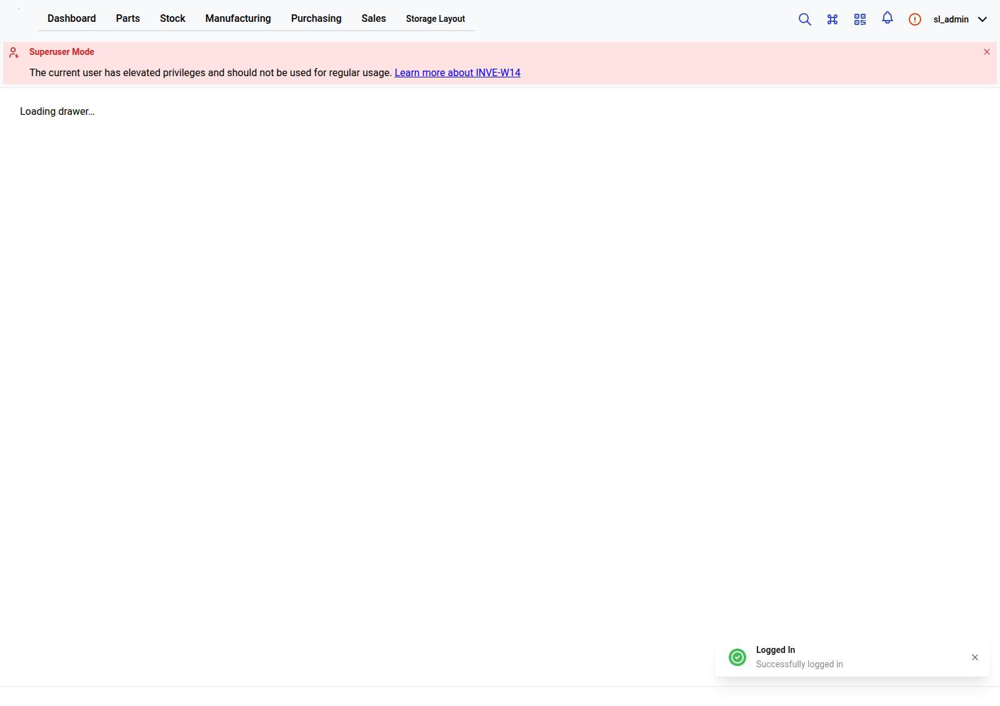

# Viewport workspace correction — Development accepted, 2026-10-20

Application commit: `f099aa1d315a20807a88b3c62dc70c8ee4095b5b`.
Committed git archive SHA-256: `adb26809b481a1d0879d6b01b52a94182656b5340c953bba17646da68d98db0c`.

## Result

The shared cabinet/drawer SVG now fills a viewport-resolved workspace below its
toolbar instead of relying on an indefinite percentage-height chain. A 320px
minimum workspace supports short/narrow screens with scrolling. Initial view fits
the drawing; automatic fitting continues while the user has not manually changed
the view. Zoom, pan and Reset view disable automatic fitting. Explicit **Fit to
view** restores fitting. Unrelated object edits do not reset manual view state.

[Authenticated Chromium report, exact snapshots and screenshot hashes](workspace-631c8c10-6ed6-4453-a157-f81bd2a79c28/report.json):
**22 checks passed**, retained isolated cabinet and both independent drawers.

| Viewport | Cabinet SVG height | Each drawer SVG height |
| --- | ---: | ---: |
| 1600×1100 | 695.7px | 671.7px |
| 1280×900 | 462.9px | 438.9px |
| 425×844 | 238px | 238px |

Initial automatic fit equals explicit fit on all three editors. Actual zoom and
mouse pan survive grid toggles and responsive resize; explicit Fit restores the
view. No horizontal document overflow at tested widths. Exact before/after
layout, background metadata, populated stock, native locations, electrical data,
active mapping and allocations match, including revisions. No save requests or
fixture mutations. Browser rejects non-read requests except authentication;
expected host observability POSTs were blocked and recorded.

## Validation

- `npm test`: **331 passed**, 17 files.
- `npm run typecheck`: passed.
- `npm run build`: passed, including TypeScript and Vite.
- `npx biome check src/components/editor/EditorCanvas.tsx tests/editor-canvas.test.tsx`: passed.
- Full `npm run lint`: existing formatting failure in unrelated `tests/commands.test.ts`; left untouched.
- `SL_WORKSPACE_APPROVED=1 node contrib/remote-development/live-workspace-acceptance.cjs`: **22 passed**, real authenticated deployed Chromium, no mocked API success.
- No backend/schema changes; backend test suite not rerun for this frontend-only fix.

## Deployment provenance and safety

Both Dockerfile targets built from the securely extracted, hash-verified committed
archive in fresh `/home/spetchal/myinventree-dev-workspace-f099aa1d3-v2`.
Installed Compose byte-matched repository policy before tagging/activation.
Baseline running IDs verified and rollback tags preserved:
`localhost/myinventree-dev-{backend,frontend}:rollback-before-workspace-f099aa1d3`.

Exact activated image IDs:

- Backend: `sha256:65dc0f43f758c78fc7039ca0670f557a57095f99e403779c7a99aca2778910d1`
- Frontend: `sha256:592829d518d084ffa7bb1ab42ebcbfe522f3cabdadd9952fab52f0596e59a3c6`

Activation used strict SSH and the restricted deploy key with canonical
`inventree-deploy up`. `prepare-002jq.py` `verify_activation()` passed against
separate `/var/backups/myinventree-dev/workspace-f099aa1d3-evidence`, checking exact
IDs, four healthy services, successful bootstrap, migration 0005, disabled gates,
identical mounts, unchanged db/redis identities and unrelated container identities.
Original backup `/var/backups/myinventree-dev/20261020T091716Z` and prior 0005
restore/rehearsal evidence retained, not recreated; provenance explicitly recorded.
No fresh backup/restore claimed. No Main, hardware, worker or shared-record actions.

An initial build preflight stopped safely because the imported helper's default
argument still referenced its historical baseline; explicit current baseline fixed
that check, then extraction/build used a fresh v2 directory. Initial bare `up` was
rejected by the restricted dispatcher; canonical command succeeded. First browser
run required allowing the 2px border when asserting the 240px paper minimum; only
the complete successful run is published as acceptance evidence.

## Limits

425px retains existing vertically stacked side panels and requires vertical
scrolling; this correction is not a mobile panel redesign. Below 425px remains
host-gated and was not tested. Extreme aspect ratios are covered only by existing
unit tests, not exhaustive live fixtures. Prior cross-owner and 390px gesture
limits remain unchanged. No new restart-persistence or upload/security claim is
made: this read-only workspace run did not repeat those prior suites. Credentials
were obtained privately and held in process memory, never written to evidence.
